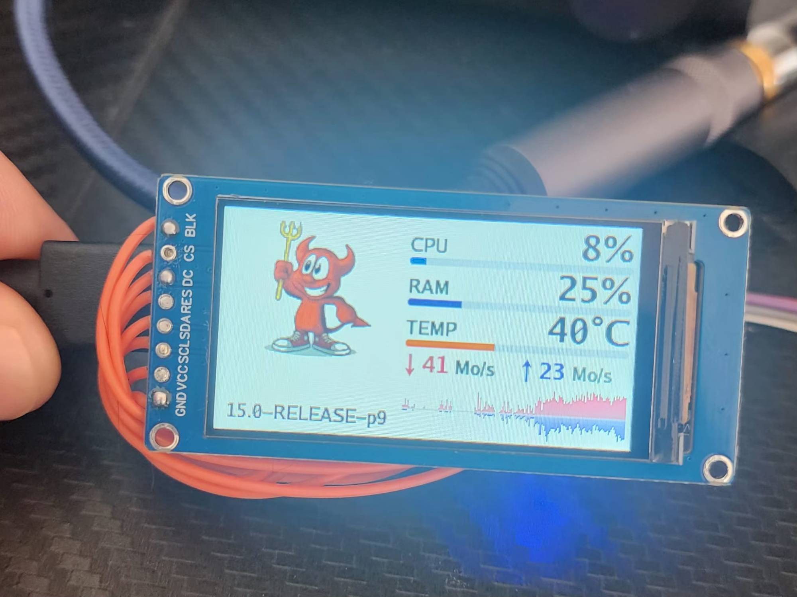
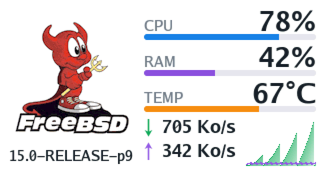
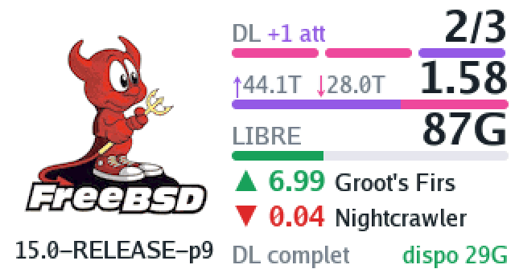
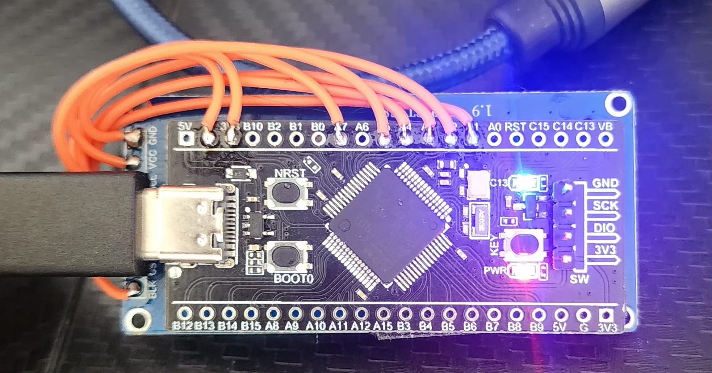

# sysmonF401

USB system monitor for a FreeBSD server: a **WeAct Studio Black Pill STM32F401** (USB-C)
drives a **1.9" ST7789 TFT** (170x320) and shows CPU, RAM, CPU temperature and network
download / upload rates, sent once a second by the server over USB serial.



| Folder | Runs on | Content |
|---|---|---|
| [firmware/sysmonf401](firmware/sysmonf401) | Black Pill F401 | STM32CubeIDE project (HAL, USB CDC, ST7789 driver) |
| [freebsd](freebsd) | FreeBSD server | `sysmonf401` sender (Go) and its rc.d service |

| System page | Torrents page | Waiting for the server |
|---|---|---|
|  |  |  |

*Rendered by the firmware's own drawing code on a PC (`tools/preview`), scaled up ×2.*

- White background. Left: an animated GIF (FreeBSD's Beastie by default), with the
  system version underneath (`uname -r`, e.g. 15.0-RELEASE-p9).
- Right: CPU, RAM and CPU temperature in large anti-aliased digits with a bar each
  (red above 80 %, or from 75 °C); download (pink) and upload (violet) rates on one
  line, and their history over ~3 min as a mirrored graph across the full width:
  download above the axis, upload below, each with its own scale.
- When the server sends the summary of [c411_transmission](https://github.com/k-vanier/c411_transmission)
  (`/var/log/torrents_status`), the right column switches every 10 s between that system
  page and a torrents page made of cards:
  - **DL**: downloads / slots (`2/3`) and added `.torrent` files still waiting (`+1 att`);
    one pill per slot, pink filled to each download's progress, violet for a waiting one;
  - **RATIO**: global ratio, green from 1, orange below; the bar shows sent (violet)
    against received (pink) since ever;
  - **disk**: `dispo 29G` on the left, `87G libre` on the right; the whole bar is the free
    space, the green part what is left for new additions, the pale pink part what is
    already promised (downloads in progress, c411's minimum free space); all red with
    `manque` when space is missing;
  - the best and worst finished torrents (▲ green, ▼ red, ratio and name), then torrents
    in error (red), what the last run did (`DL complet`, `RAS`...) and the totals sent ↑ /
    received ↓ since ever. A summary older than an hour shows its age in orange; c411's
    error line shows as a pale red card.
  The torrents page is left out when no summary arrived for 30 s (file missing).

## Wiring

The screen is driven by SPI1. USB uses PA11 / PA12, SWD uses PA13 / PA14.



| ST7789 pin | Black Pill pin |
|---|---|
| GND | GND |
| VCC | 3V3 |
| SCL | PA5 (SPI1 SCK) |
| SDA | PA7 (SPI1 MOSI) |
| RES | PA2 |
| DC | PA3 |
| CS | PA4 |
| BLK | PA1 (backlight on / off) |

The blue LED (PC13) toggles on every line received.

## Firmware

STM32CubeIDE project generated by STM32CubeMX (`sysmonf401.ioc`, STM32F401CCUx,
firmware package FW_F4 V1.28.3):

- 25 MHz crystal, core at 84 MHz, USB at 48 MHz;
- USB device CDC (virtual COM port), VID `0483` / PID `5740`, product "SysMon F401";
- SPI1 master at 21 Mbit/s, pins `TFT_CS`, `TFT_DC`, `TFT_RST`,
  `TFT_BLK`, `LED`.

Application code (kept when CubeMX regenerates the project):

| File | Content |
|---|---|
| `Core/Src/st7789.c`, `Core/Inc/st7789.h` | ST7789 driver: init, rectangles, pixel streaming |
| `Core/Src/gfx.c`, `Core/Inc/gfx.h` | Anti-aliased text, bars, rounded rectangles, GIF frame decoding |
| `Core/Src/assets.c`, `Core/Inc/assets.h` | Fonts and animation, generated by `tools/mkassets.py` |
| `Core/Src/sysmon.c`, `Core/Inc/sysmon.h` | Line parsing and dashboard layout |
| `Core/Src/main.c` | `sysmon_init()` / `sysmon_loop()` in the USER CODE sections |
| `USB_DEVICE/App/usbd_cdc_if.c` | `sysmon_rx()` in `CDC_Receive_FS`, USER CODE 6 |

Upside-down mounting: `#define FLIP 1` at the top of `sysmon.c`.

### Fonts and animation

`tools/mkassets.py` (Python 3 + Pillow) writes `Core/Src/assets.c` and `Core/Inc/assets.h`:

- three anti-aliased fonts (16 alpha levels) rendered from the
  [Go fonts](https://go.dev/blog/go-fonts) (BSD licence), found in the Go module cache
  (`go mod download golang.org/x/image`) or in the folder given by `GOFONTS`;
- the animation: every frame cropped (`--crop`, or automatically to the subject), scaled
  to fit 136x120, its near-white background turned pure white to match the screen, one
  palette of 64 colours for all frames. Pixels are stored column by column (the panel's
  refresh axis in landscape, so a frame change never shows as a diagonal tear). The first
  frame is stored whole, then each frame only as its changes from the previous one;
  colours close to the one already shown are kept, which drops the GIF's compression
  noise. The firmware keeps the current frame in RAM (`ANIM_PIXELS` bytes) and only
  sends the parts of columns that change.

The current animation is `tools/beastie_trident.gif` (8 s, 120 frames), built with:

```
pip install pillow
python tools/mkassets.py --crop 135,12,485,346 --noise 800 --max-h 128 --gamma 0.5 tools/beastie_trident.gif firmware/sysmonf401
```

It keeps one frame in two (`--step 2`, 60 frames of 133 ms, 134x128, 154 KB), brightened
(`--gamma 0.5`); the firmware takes 230 KB of the F401CC's 256 KB of flash. For another GIF (white background
works best), run the script with its path and look at the sizes it prints; for a longer
or larger one, raise `--step` or `--noise`, or lower `--max-h` / `--colors`. Then build and
flash.

The BSD Daemon (Beastie) in `tools/beastie_trident.gif` and in the generated `assets.c` is
Copyright 1988 by Marshall Kirk McKusick, all rights reserved; see
[his page](https://www.mckusick.com/beastie/) for the terms of use.

### Preview on a PC

`tools/preview` compiles the real `sysmon.c`, `gfx.c` and `assets.c` on a PC with a fake
display driver, replays a scenario and writes screenshots (PPM, 320x170). It needs a C
compiler (`gcc`, `clang` or `zig cc`). It also checks that the animation comes back exactly
to its first frame after a full loop:

```
CC="zig cc" sh tools/preview/build.sh /tmp/preview
```

### Build and flash with an ST-Link

1. Wire the ST-Link to the 4-pin SWD header at the end of the board:
   **GND**, **SWDIO** (DIO), **SWCLK** (CLK), and **3V3** only if the board is not
   powered by USB-C at the same time.
2. In STM32CubeIDE: *File > Import > General > Existing Projects into Workspace*,
   select `firmware/sysmonf401` (not the repository root), leave "Copy projects into
   workspace" unticked.
3. *Project > Build Project*, then *Run > Run As > STM32 C/C++ Application*
   (debug probe: ST-LINK GDB server, interface SWD). The board resets on the new firmware.
   Check that the run configuration is "sysmonf401 Debug", not one from another project.

Check on the server that the right firmware runs:
`usbconfig -d ugen0.2 dump_device_desc | grep -i iProduct` must show `<SysMon F401>`.

#### ST-Link V2 clones

STM32CubeProgrammer (and so CubeIDE's ST-LINK GDB server) may refuse a clone ST-Link V2
(`0483:3748`, no serial number) with `ST-LINK error (DEV_CONNECT_ERR)`. The OpenOCD
shipped with CubeIDE works with it, through the `stlink-dap` interface. From Git Bash,
after a build (close CubeIDE first, the probe serves one tool at a time):

```
P=/c/ST/STM32CubeIDE_2.1.1/STM32CubeIDE/plugins
O=$(echo $P/com.st.stm32cube.ide.mcu.externaltools.openocd.win32_*/tools/bin/openocd.exe)
S=$(echo $P/com.st.stm32cube.ide.mcu.debug.openocd_*/resources/openocd/st_scripts)
"$O" -s "$S" -f interface/stlink-dap.cfg -c "transport select dapdirect_swd" \
  -f target/stm32f4x.cfg -c "adapter speed 400" \
  -c "program firmware/sysmonf401/Debug/sysmonf401.elf verify reset exit"
```

It ends with `** Verified OK **` and resets the board. Adjust the CubeIDE path to your
version. `interface/stlink.cfg` does not work with these scripts, use `stlink-dap.cfg`.

Flashing at `0x08000000` replaces the WeAct HID bootloader the board ships with; this is fine,
the ST-Link (or the ST ROM bootloader) is enough for later updates.

After a reset the board shows up as a USB CDC ACM serial port, and the screen says
"En attente du serveur" until data arrives.

## FreeBSD sender

Build (Go 1.26 or later), on FreeBSD:

```
cd freebsd
go build -o sysmonf401 .
```

Or cross-compile from another machine: `GOOS=freebsd GOARCH=amd64 go build -o sysmonf401 .`

The board is handled by `umodem(4)`, which creates `/dev/cuaU0`. Check it:

```
usbconfig | grep -i 0483
sysctl dev.umodem
```

If `umodem` is not loaded: `kldload umodem` (and `umodem_load="YES"` in `/boot/loader.conf`).
For the CPU temperature: `kldload coretemp` (Intel) or `kldload amdtemp` (AMD), and
`sysrc kld_list+=coretemp` to keep it at boot.

`/dev/cuaU*` belongs to `uucp:dialer`: run as root, or add the user to `dialer`.

Try it by hand:

```
./sysmonf401
```

Options:

| Option | Default | Meaning |
|---|---|---|
| `-port /dev/cuaU0` | automatic | Serial port; found by VID/PID `0483:5740` if empty (`cuaU0` alone also works) |
| `-interval 1s` | `1s` | Update period |
| `-iface em0,igb1` | all but `lo*` | Interfaces counted for the network rates |
| `-label text` | `uname -r` | Text shown under the animation, e.g. `15.0-RELEASE-p9` |
| `-brightness N` | unchanged | Backlight: 0 = off, anything else = on |
| `-no-arc` | off | Do not count the ZFS ARC as used RAM |
| `-torrents path` | `/var/log/torrents_status` | Summary of c411_transmission, read and sent every 5 s; empty = none |

With jails, bridges or VLANs, the same traffic is counted on several interfaces:
use `-iface` with the physical interface.

### Service at boot

Same as miniscreen: `daemon(8)` restarts `sysmonf401` 5 s after any exit (board unplugged,
not attached yet) and sends its output to syslog (tag `sysmonf401`). As root, from `freebsd/`:

```
install -m 755 sysmonf401 /usr/local/bin/sysmonf401
install -m 555 rc.d/sysmonf401 /usr/local/etc/rc.d/sysmonf401
sysrc sysmonf401_enable=YES
sysrc sysmonf401_args="-iface em0"
service sysmonf401 start
```

When the data stops, the board's blue LED goes off after 5 s, and the screen goes back to
"En attente du serveur" after one minute.

## Protocol

One text line per sample, `key=value` pairs separated by spaces, ending with `\n`:

```
cpu=12.5 ram=43.1 temp=52.0 down=123456 up=7890 os=15.0-RELEASE-p9
```

| Key | Value |
|---|---|
| `cpu`, `ram` | Percent used |
| `temp` | CPU temperature, °C |
| `down`, `up` | Network rates, bytes per second |
| `os` | Text under the animation, `_` for spaces (`host` is accepted too) |
| `bri` | Backlight: 0 = off, anything else = on; can be sent alone |

A missing key shows `--`. So the board can be fed by anything, for example from a shell:
`echo "cpu=50 ram=20 os=test" > /dev/cuaU0`.

Every 5 s the sender adds a second line with the torrents summary (keys starting with `t`,
built by `freebsd/torrents.go` from c411's line, `_` for spaces):

```
tdl=2 tmax=3 tpct=87,45 tatt=1 tfree=87G tavail=29G tup=44.1T tdown=28.0T tratio=1.58
terr=1 ttopr=6.99 ttopn=Groot's_Firs tflopr=0.04 tflopn=Nightcrawler tact=DL_complet tage=720
```

`tneed` replaces `tavail` when space is missing, `terror` carries c411's error line, `tage`
is the age of the summary in seconds.

Sources: `kern.cp_time` (CPU), `hw.physmem` and `vm.stats.vm.*` (RAM, available = free +
inactive + laundry pages, as in `top`), `dev.cpu.N.temperature` (hottest core),
`netstat -ibn --libxo json` (network).
